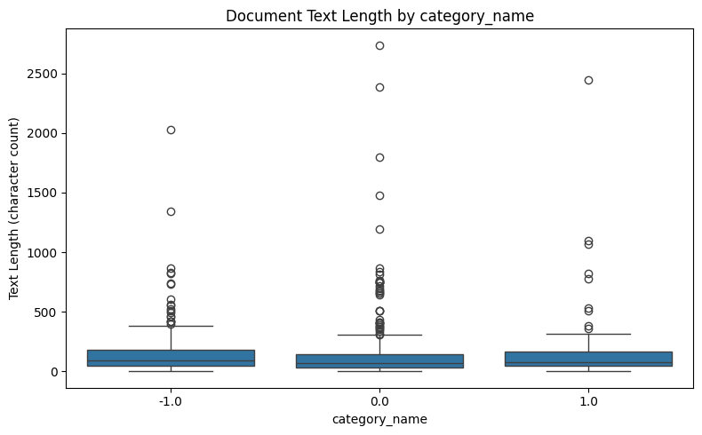
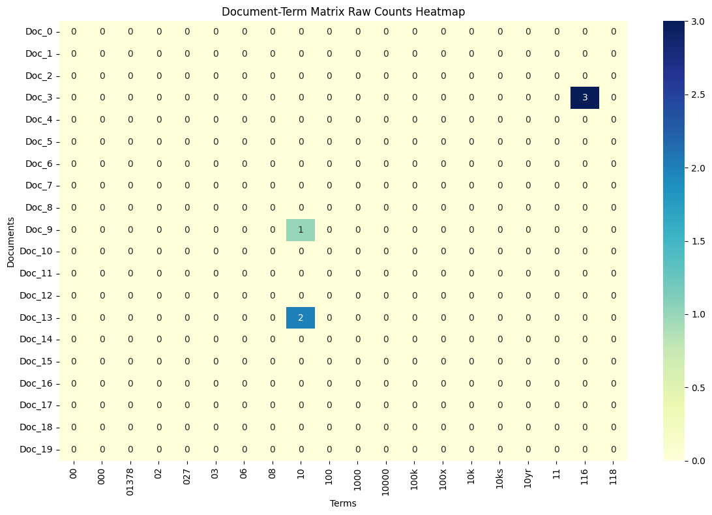
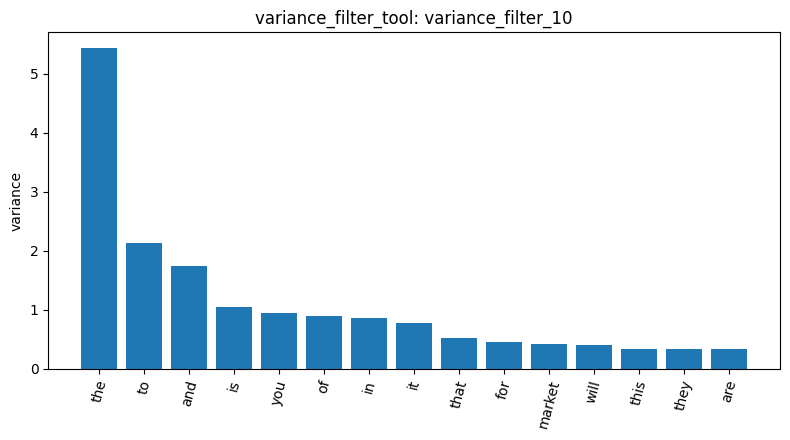
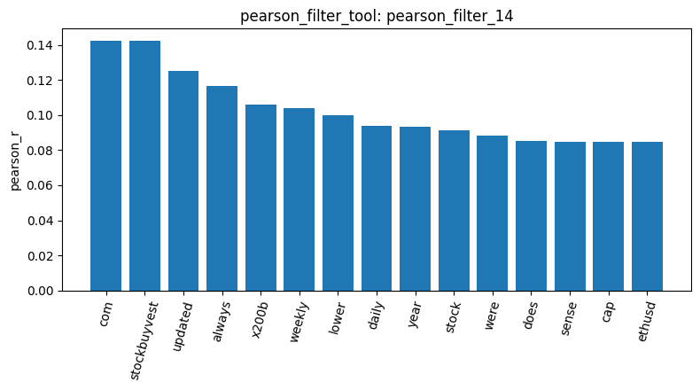
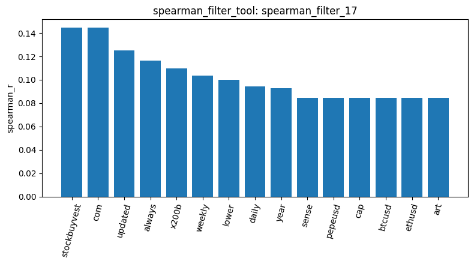
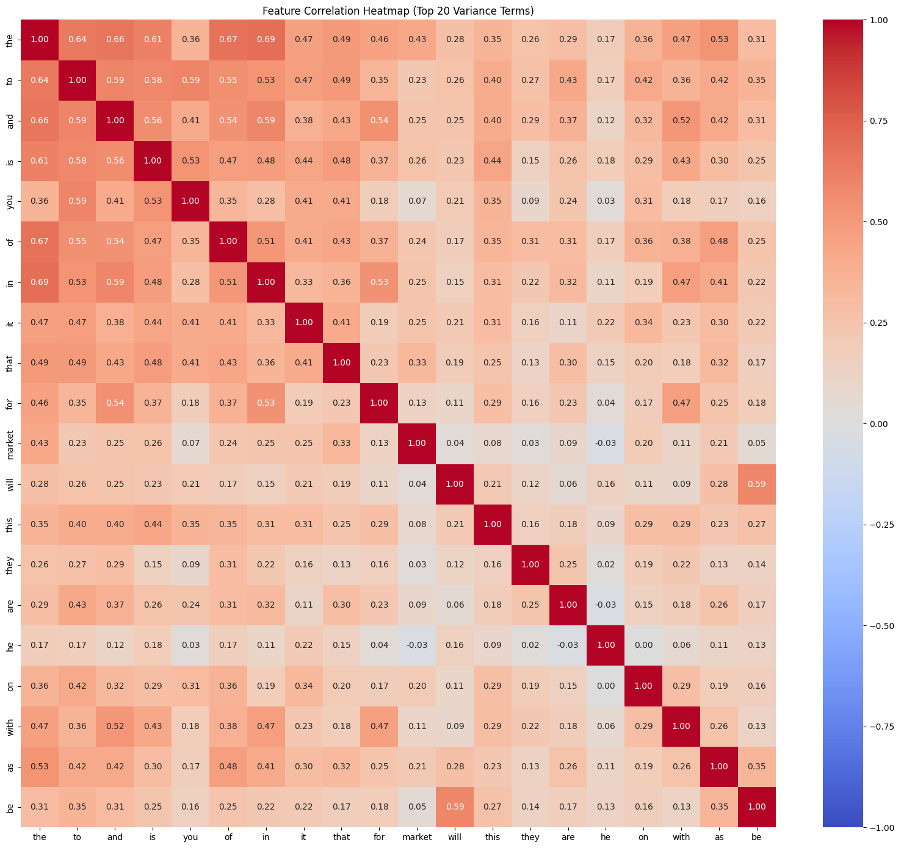
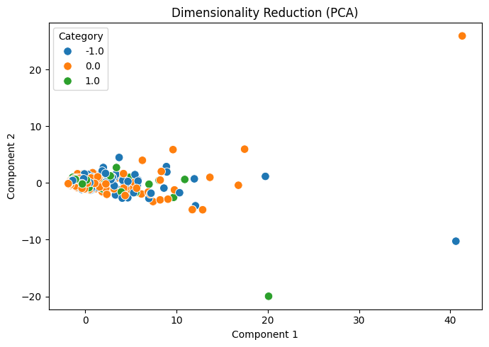
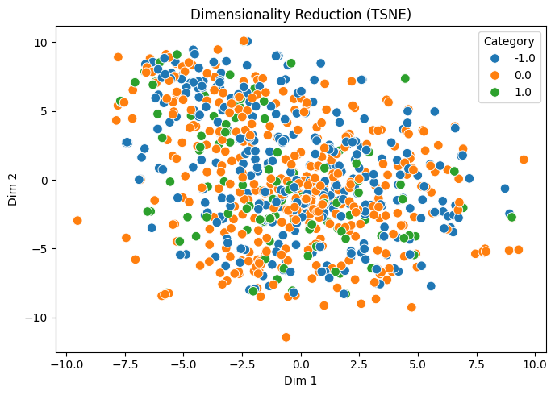
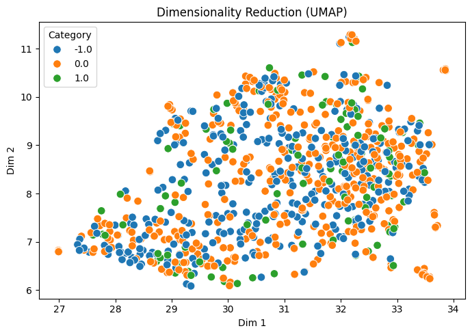

#  Agentic Data Mining Homework Report

### Data Preprocessing and Feature Creation
We started by loading the Reddit stock sentiment dataset with 847 documents across three sentiment label "0.0", "-1.0", and "1.0" (`load_dataset_1`). To ensure clean data, we checked for missing text (`check_missing_3`, 0 missing) and duplicates (`check_duplicates_4`, 34 found). Checking document lengths (`describe_data_5`) helped us understand text size differences across sentiment groups. Because our dataset is small, we don't really need to do sampling(`sample_data_6`). 
<figure align="center">
  
  <figcaption style="text-align: center;"><b>Figure 1:</b> Document length distribution (describe_data_5).</figcaption>
</figure>

Next, we built a Document-Term Matrix (`build_dtm_7`) to turn raw text into numbers, yielding 4,346 terms with 99.53% sparsity. To inspect the word distribution, we aggregated term frequencies (`term_frequency_8`) and visualized a matrix slice using a heatmap (`dtm_heatmap_9`). 
<figure align="center">
  
  <figcaption style="text-align: center;"><b>Figure 2:</b> Document-term matrix frequency heatmap (dtm_heatmap_9).</figcaption>
</figure>

To evaluate feature reduction, we ran independent trials of variance filtering at various thresholds (`variance_filter_10 to 13`) to see how stricter cutoffs remove near-constant noise. We also applied Pearson (`pearson_filter_14 to 16`) and Spearman (`spearman_filter_17 to 19`) correlation filters separately against each target sentiment class.
<figure align="center">
  
  <figcaption style="text-align: center;"><b>Figure 3:</b> Variance Filter with threshold=0.0 (variance_filter_10).</figcaption>
</figure>

<figure align="center">
  
  <figcaption style="text-align: center;"><b>Figure 4:</b> Pearson Filter with category=0.0, threshold=0.0 (pearson_filter_14).</figcaption>
</figure>

<figure align="center">
  
  <figcaption style="text-align: center;"><b>Figure 5:</b> Spearman Filter with category=0.0, threshold=0.0 (spearman_filter_17).</figcaption>
</figure>

Additionally, a global feature correlation analysis was performed(`feature_correlation_matrix_20`). The resulting heatmap revealed term relationships, where strong off-diagonal anti-correlations highlighted competing or mutually exclusive indicators among high-variance terms.

<figure align="center">
  
  <figcaption style="text-align: center;"><b>Figure 6:</b> Feature Correlation Matrix Heatmap(feature_correlation_matrix_20).</figcaption>
</figure>

### Frequent Pattern Mining
Building upon our filtered features, we conducted frequent pattern mining using the FP-Growth algorithm to discover underlying term associations and co-occurrences within specific sentiment domains. Initial trials showed that setting strict support thresholds yielded zero patterns, whereas adjusting the minimum support (min_sup) successfully captured frequent itemsets. For instance, variance-filtered mining for neutral sentiment (Category 0.0) yielded 1,117 patterns at min_sup=5 (`mine_patterns_7`). For negative sentiment (Category -1.0), lowering min_sup from 10 down to 2 scaled pattern counts from 0 up to 721 (`mine_patterns_6 to 10`). Similarly, positive sentiment (Category 1.0) scaled from 7 patterns at min_sup=5 to 429 patterns at min_sup=2 (`mine_patterns_11 to 13`). Additional explorations tested TF-IDF and term-frequency filtering methods (`mine_patterns_28 to 34`), revealing how support thresholds and filtering techniques directly govern pattern discovery and granularity.

### Dimensionality Reduction
To evaluate how effectively our features separate semantic sentiment categories in continuous space, we applied dimensionality reduction and manifold learning techniques. Linear PCA reduction in 2D (`reduce_dimensions_14`) achieved a cumulative variance explained by Component 1 (27.0%) and Component 2 (4.99%), providing a global projection. 

<figure align="center">
  
  <figcaption style="text-align: center;"><b>Figure 7:</b>  Reduce dimensions using PCA in 2D (reduce_dimensions_14).</figcaption>
</figure>

To capture non-linear local neighborhood structures, t-SNE was tested with perplexity values of 30.0, 50.0, and 15.0 (`reduce_dimensions_15 to 17`), alongside UMAP with varying neighbor parameters (`reduce_dimensions_18 to 20`). These spatial projections mapped the 847 documents and revealed how sentiment instances cluster within the reduced vector space.

<figure align="center">
  
  <figcaption style="text-align: center;"><b>Figure 8:</b>   Reduce dimensions using TSNE in 2D with perplexity=30.0 (reduce_dimensions_14).</figcaption>
</figure>

<figure align="center">
  
  <figcaption style="text-align: center;"><b>Figure 9:</b>   Reduce dimensions using UAMP in 2D with n_neighbors=15(reduce_dimensions_18).</figcaption>
</figure>

### Binarization and Data Exploration
In the final transition from exploratory analysis to predictive modeling readiness, target sentiment labels were transformed into binary attributes via One-Hot Encoding (`binarize_labels_21`) across the 3 classes (`-1.0`, `0.0`, `1.0`), satisfying downstream machine learning input requirements. Finally, to evaluate instance-level semantic proximity within the vector space, cosine similarities were computed between document pairs (e.g., Document 0 and Document 1 in `cosine_similarity_22`, up to Document 77 and Document 1 in `cosine_similarity_27` with a score of 0.1306). The resulting similarity scores reflect expected baseline term overlap and lexical divergence across raw stock posts, successfully completing our end-to-end data mining pipeline workflow.